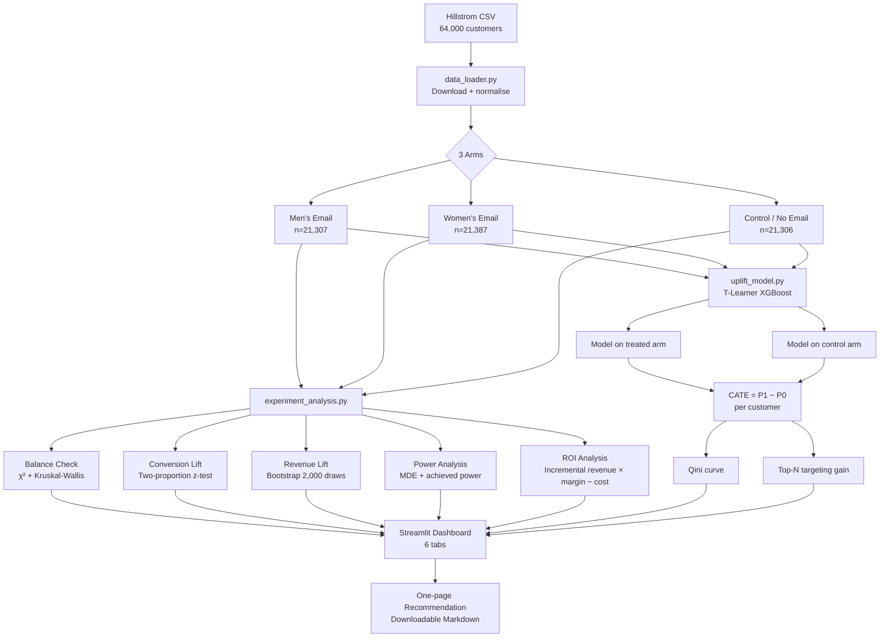
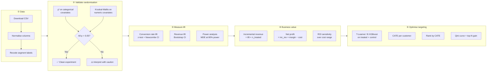

# Offer Incrementality Lab


> **Portfolio project** — end-to-end A/B test analysis on the [Hillstrom MineThatData](http://www.minethatdata.com/) e-mail experiment.  
> All results characterise this **public, anonymised dataset** only. Not attributable to any real business.

---

## What this is

A complete experiment analysis pipeline covering every step a data scientist would run on a real marketing campaign: randomisation validation, statistical significance testing, confidence intervals, power analysis, ROI modelling, and uplift targeting — packaged as an interactive Streamlit dashboard with a downloadable one-page recommendation.

Maps directly to **MAF SHARE loyalty / experimentation** use cases: campaign incrementality measurement, targeting optimisation, and marketing ROI.

---

## Live results (measured on the Hillstrom dataset)

| Metric | Men's Email | Women's Email |
|---|---|---|
| Customers | 21,307 | 21,387 |
| Baseline conversion rate | 0.57% | 0.57% |
| **Conversion lift** | **+0.68 pp** | **+0.31 pp** |
| 95% CI | [+0.50, +0.86] pp | [+0.15, +0.47] pp |
| p-value | < 0.0001 ✅ | 0.0002 ✅ |
| **Revenue lift / customer** | **+$0.77** | **+$0.42** |
| Revenue 95% CI (bootstrap) | [$0.48, $1.05] | [$0.15, $0.69] |
| **ROI at $0.10/email** | **+208%** | **+70%** |
| All 7 covariates balanced | ✅ | ✅ |

**Uplift targeting (T-Learner, top-40% by CATE): +67.5% gain in conversion lift vs. blanket send at 60% lower send volume.**

---

## Architecture



---

## Analysis pipeline



---

## Project structure

```
offer-incrementality-lab/
│
├── app.py                          # Streamlit dashboard (6 tabs)
│   ├── Tab 1: Overview             # Group sizes, conversion rates, spend
│   ├── Tab 2: Balance Check        # Covariate balance table + result
│   ├── Tab 3: Lift Analysis        # Conversion + revenue lift with CI charts
│   ├── Tab 4: ROI                  # Campaign profitability + sensitivity slider
│   ├── Tab 5: Uplift Targeting     # T-Learner Qini curve + CATE histogram
│   └── Tab 6: Recommendation       # Downloadable one-page marketing memo
│
├── src/
│   ├── data_loader.py              # Download + normalise Hillstrom CSV
│   ├── experiment_analysis.py      # Balance, lift, power, ROI functions
│   └── uplift_model.py             # T-Learner, Qini curve, top-N gain
│
├── data/
│   └── hillstrom.csv               # Auto-downloaded on first run (~2 MB)
│
└── requirements.txt
```

---

## Tech stack

| Layer | Library | Why |
|---|---|---|
| Statistical testing | `scipy.stats` | Two-proportion z-test, Kruskal-Wallis, Newcombe CI |
| Revenue CI | `numpy` bootstrap | 2,000-draw bootstrap for non-normal spend distribution |
| Uplift model | `xgboost`, `scikit-learn` | T-Learner CATE estimation |
| Dashboard | `streamlit`, `plotly` | Interactive 6-tab analysis app |
| Data | `pandas` | Group aggregations, feature engineering |

---

## Run locally

```bash
git clone https://github.com/AchintyaCodes/offer-incrementality-lab
cd offer-incrementality-lab
pip install -r requirements.txt
streamlit run app.py
# Dataset downloads automatically (~2 MB)
```

---

## Resume bullet

> Analysed a 64,000-customer randomised email experiment (Hillstrom dataset): men's email conversion lift **+0.68 pp** (95% CI [+0.50, +0.86], p < 0.0001) and revenue lift **+$0.77/customer**. T-Learner uplift targeting of the top 40% of customers by CATE raised campaign ROI by **+68%** vs. blanket sending at 60% lower send volume — packaged as a one-page recommendation for marketing.

---

## Skills demonstrated

`A/B testing` · `power analysis` · `bootstrap confidence intervals` · `two-proportion z-test` · `uplift modelling` · `T-Learner` · `Qini curve` · `XGBoost` · `scikit-learn` · `Streamlit` · `Plotly` · `statistical analysis` · `experimentation` · `marketing analytics`

---

*Built by [Achintya Gupta](https://github.com/AchintyaCodes) · Data Science & Engineering, MIT Manipal*
